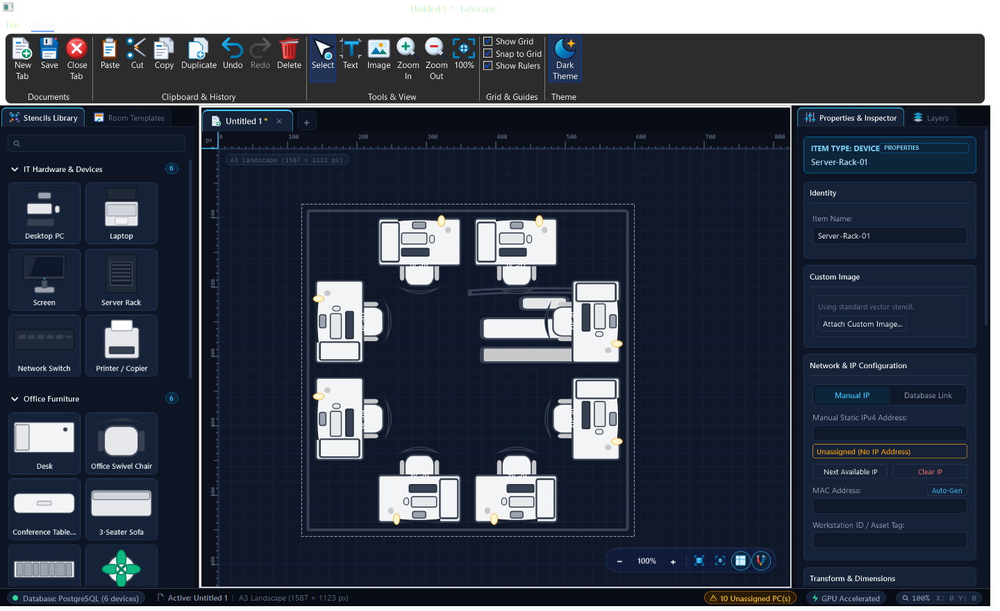
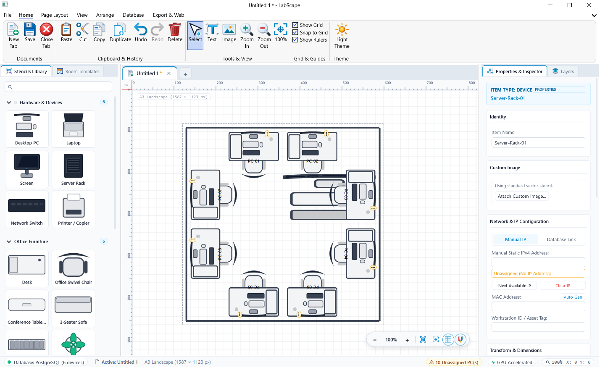
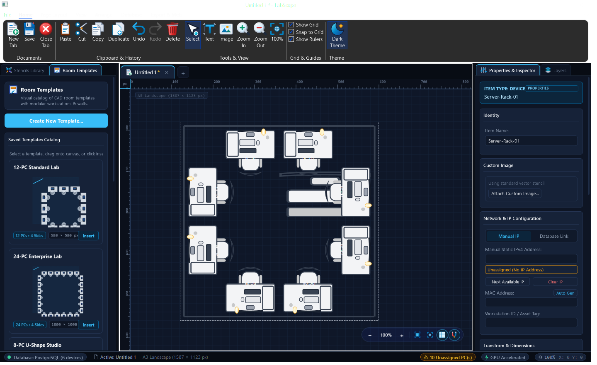
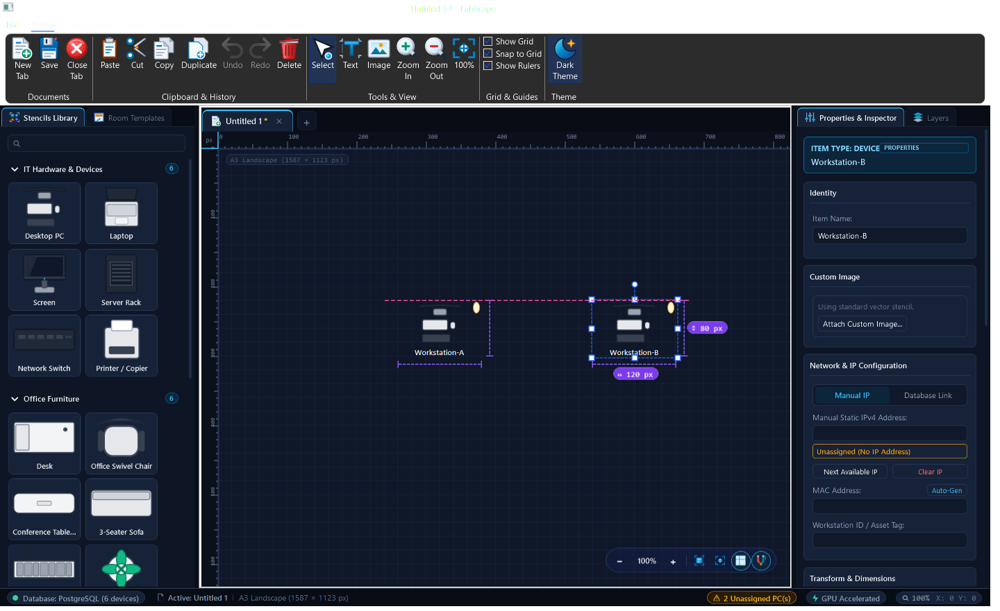
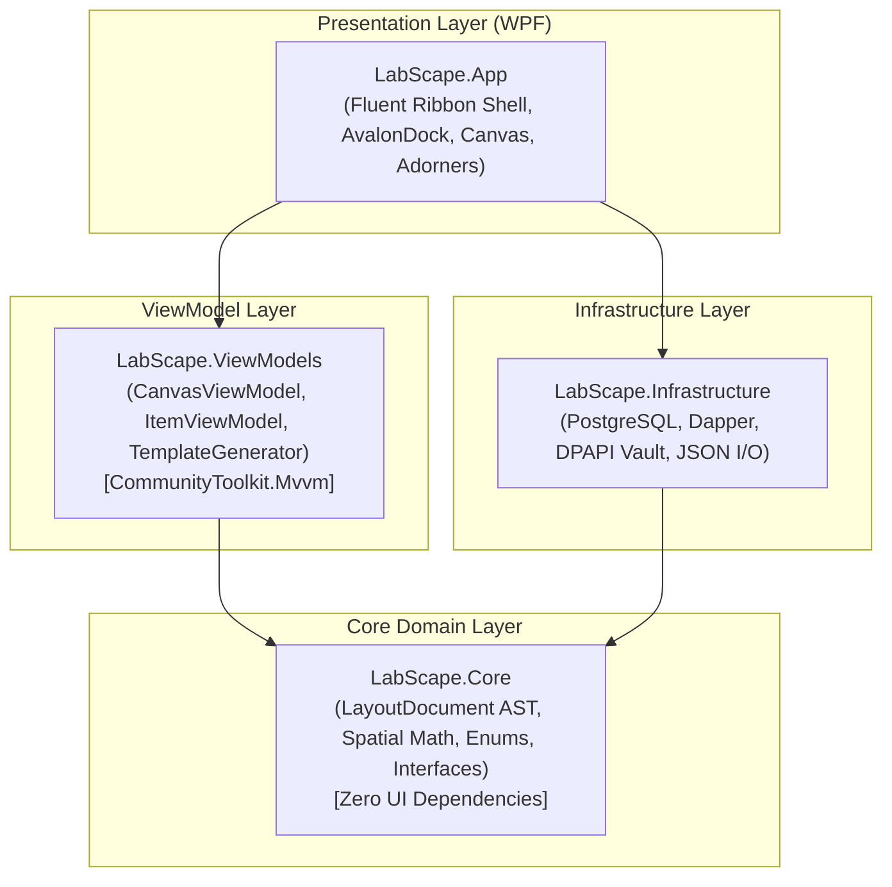

# LabScape — Precision CAD & Lab Layout Designer

[-blue.svg?style=flat-square)](https://dotnet.microsoft.com/)
[](https://dotnet.microsoft.com/)
[](docs/ARCHITECTURE.md)
[](src/LabScape.App/Resources/Icons.xaml)
[](tests/LabScape.Tests)
[](#)
[](docs/SCHEMA.md)

**LabScape** is a professional, high-performance CAD layout and floorplan drafting application engineered specifically for IT computer laboratories, server rooms, network operations centers (NOC), and modular workstation facilities.

Combining the familiar ergonomics of **Microsoft Office & Microsoft Visio** with precision CAD drafting, parametric room generation, PostgreSQL asset synchronization, and standalone HTML5 web viewing, LabScape streamlines physical IT infrastructure planning from initial concept to digital twin deployment.

---

## 📸 Screenshots & Visual Overview

### Primary Workspace (Dark Theme)


### Modern Precision Workspace (Light Theme)


<details>
<summary><b>🔍 View More Screenshots (Room Templates Catalog &amp; Size Assist Engine)</b></summary>

#### Parametric Room Templates Catalog &amp; 2D Previews


#### Equal Size Assistance &amp; Magnetic Snapping (Visio / Draw.io Style)


</details>

---

## 🌟 Key Highlights & Capabilities

### 1. Fluent Office & Visio CAD Workspace
* **Fluent Ribbon Interface**: Organized command hierarchy featuring dedicated **Home**, **Arrange**, **Insert**, **Layout**, **Database**, and **View** tabs (`Fluent.Ribbon`).
* **Multi-Shaded Vector Icon Suite**: Over 47 custom-crafted, multi-tone gradient vector icons with specular highlights matching authentic Microsoft 365 and Microsoft Visio aesthetics.
* **Canvas Center Dock Reservation**: Powered by `AvalonDock` with the central workspace permanently pinned and non-undockable, preventing tool windows from displacing the floorplan.
* **Browser-Style Multi-Document Tabs**: Seamlessly switch between multiple open floorplan documents with dedicated tab controls.

### 2. Precision Drafting Canvas & Adorner Engine
* **Fluid Hardware-Accelerated Viewport**: Continuous smooth zoom ($10\%$ to $1000\%$) centered directly on the cursor, middle-click & `Space + Drag` canvas panning.
* **Dual Real-Time Rulers & Adaptive Grid**: Synchronized metric and pixel rulers tracking cursor coordinates $(X, Y)$ alongside Cartesian grid modes (dots and lines) with snap-to-grid support.
* **8-Point Transform Handles**: Intuitive bounding-box resize, aspect-ratio constraint (`Shift`), center-anchored scaling (`Alt`), and 360° rotation grip.
* **Parametric Geometry Handles**:
  * *Corner Radius Handles* for rounded rectangles and rounded triangles.
  * *Inner Hole Radius Handles* for donut shapes.
  * *Tangent Control Handles* for cubic and quadratic Bézier curve walls.
* **Organization & Layering**: Multi-selection marquee, hierarchical grouping (`Ctrl+G`), ungrouping (`Ctrl+Shift+G`), alignment tools (Left, Center, Right, Top, Middle, Bottom), distribution spacing, and Z-index layer stack controls.
* **First-Class Typography**: Built-in `TextItem` support with inline double-click editing and live font property inspector.

### 3. Parametric Room Template Generator & Visual Catalog
* **Interactive Generator Modal**: Configure room boundaries and workstation requirements on the fly:
  * *4 Sides*: Fully enclosed rooms with configurable door swings.
  * *3 Sides*: U-shaped collaborative studios with customizable entrance openings (North, South, East, West).
  * *2 Sides*: Corner L-shaped layouts or facing opposite rows.
  * *1 Side*: Single bench and perimeter wall rows.
* **Automated Furniture Layout**: Distributes 1 to 48 PCs on modular desks ($120 \times 70\,\text{px}$) with ergonomic swivel chairs positioned forward and tucked under tabletops.
* **Visual Thumbnail Catalog**: Persistent docked catalog showcasing live 2D CAD blueprint previews for instant recognition without verbose text clutter.
* **Direct Canvas Insertion & Drag-and-Drop**: Drag visual template cards directly onto the canvas or generate at the canvas origin with one click.

### 4. Vector Stencil Catalog & Asset Taxonomy
* **IT Hardware**: Desktop PCs, Laptops, Dual-Monitors, and Server Racks (1U to 48U standard and IBM formats).
* **Office Furniture**: Ergonomic Swivel Chairs, Modular Desks, 8-Person Conference Tables, and Lounge Sofas.
* **CAD Primitives**: Full set of 2D shapes including Rectangles, Circles, Triangles, Semicircles, Donuts, and Freehand Lines.

### 5. PostgreSQL Asset Synchronization & IP Management
* **Database Integration**: Connects directly to enterprise PostgreSQL instances using `Npgsql` and `Dapper`.
* **Hardware Inventory Sync**: Binds floorplan nodes directly to live hardware inventory records, MAC addresses, and hostnames.
* **Real-Time IP Conflict Detection**: Validates subnet assignments and flags duplicate IPv4 addresses across the canvas.
* **Secure Credential Vault**: Protects database connection strings using Windows Data Protection API (DPAPI).

### 6. Interactive HTML5 / SVG Web Viewer
* **Zero-Install Web Export**: Exports complete floorplans to standard JSON alongside a standalone interactive web viewer (`web-viewer/index.html`).
* **Interactive Navigation**: Explore layouts directly inside any modern web browser with pan, zoom, layer toggles, and device inspector popups.

### 7. Robust Undo / Redo Engine
* **Command-Pattern Undo History**: Full 100-state history stack covering insertions, moves, transformations, grouping, ungrouping, and property updates.

---

## 🏛️ Architecture & Project Structure

LabScape follows strict **Clean Architecture** and **MVVM (Model-View-ViewModel)** principles implemented in modern **.NET 10**:



### Solution Projects

| Project | Target | Description |
| :--- | :--- | :--- |
| **`LabScape.Core`** | `net10.0` | Pure domain models, mathematical geometry engines, quad-tree spatial indexes, and abstract contracts. Contains zero UI dependencies. |
| **`LabScape.Infrastructure`** | `net10.0` | Data access via PostgreSQL (`Npgsql`, `Dapper`), Windows DPAPI credential vault, and JSON serializer. |
| **`LabScape.ViewModels`** | `net10.0` | Presentation logic, state management, undo/redo command stack, and room generator algorithms powered by `CommunityToolkit.Mvvm`. |
| **`LabScape.App`** | `net10.0-windows` | Desktop application shell, `Fluent.Ribbon` window, `AvalonDock` workspaces, custom vector drawing dictionaries, and interactive adorners. |
| **`LabScape.Setup`** | `net10.0-windows` | Lightweight standalone self-extracting installer and desktop deployment package. |
| **`LabScape.Tests`** | `net10.0` | Comprehensive xUnit test suite (100 unit tests) validating spatial math, MVVM state, algorithms, and schema compatibility. |

---

## 🚀 Getting Started

### Prerequisites
* **Operating System**: Windows 10 or Windows 11 (64-bit).
* **Development SDK**: [.NET 10.0 SDK](https://dotnet.microsoft.com/download/dotnet/10.0) (or later).
* **IDE**: Visual Studio 2022 / 2026, JetBrains Rider, or Visual Studio Code with the C# Dev Kit.
* *(Optional)* **Database**: PostgreSQL 13+ (for live inventory synchronization).

### Installation & Launch

1. **Clone the repository**:
   ```bash
   git clone https://github.com/mjk22071998/LabScape.git
   cd LabScape
   ```

2. **Restore dependencies & build**:
   ```bash
   dotnet build LabScape.slnx
   ```

3. **Run the automated test suite**:
   ```bash
   dotnet test LabScape.slnx
   ```

4. **Launch the application**:
   * Double-click **`Launch-LabScape.bat`** (or the **`LabScape.lnk`** shortcut).
   * Or run via the .NET CLI:
     ```bash
     dotnet run --project src/LabScape.App/LabScape.App.csproj
     ```

---

## 📦 Production Release & Deployment

LabScape includes an automated PowerShell build and packaging script:

```powershell
.\build-release.ps1
```

The script executes the following pipeline:
1. Runs all automated unit tests (`dotnet test`).
2. Compiles a high-performance Release build (`dotnet publish`) into `dist\publish`.
3. Bundles and synchronizes the standalone HTML5 `web-viewer` distribution.
4. Generates a standalone installer package in `dist\setup`.

---

## ⌨️ Keyboard Shortcuts Reference

| Shortcut | Action |
| :--- | :--- |
| `Ctrl + N` | Create a new floorplan tab |
| `Ctrl + O` | Open layout JSON file |
| `Ctrl + S` | Save current floorplan |
| `Ctrl + Shift + S` | Save As... |
| `Ctrl + W` | Close active floorplan tab |
| `Ctrl + Z` | Undo last operation |
| `Ctrl + Y` | Redo operation |
| `Ctrl + X` | Cut selected items |
| `Ctrl + C` | Copy selected items |
| `Ctrl + V` | Paste items at cursor position |
| `Ctrl + D` | Duplicate selected items |
| `Delete` | Remove selected items |
| `Ctrl + A` | Select all items on canvas |
| `Ctrl + G` | Group selected items |
| `Ctrl + Shift + G` | Ungroup selected group |
| `Space + Drag` | Pan canvas |
| `Mouse Wheel` | Zoom in / Zoom out centered on cursor |
| `Shift + Resize` | Maintain aspect ratio during scale |
| `Alt + Resize` | Scale symmetrically from center |

---

## 📄 Data Interchange Specification

LabScape uses a standardized, human-readable JSON schema (Draft 2020-12) for layout persistence and web interchange:

```json
{
  "$schema": "https://json-schema.org/draft/2020-12/schema",
  "version": "1.0.0",
  "canvas": {
    "width": 2400.0,
    "height": 1600.0,
    "unit": "px",
    "gridSize": 20.0,
    "backgroundColor": "#FFFFFF"
  },
  "items": [
    {
      "id": "dev-pc-01",
      "type": "device",
      "name": "LAB-PC-101",
      "x": 320.0,
      "y": 240.0,
      "z": 3,
      "width": 80.0,
      "height": 80.0,
      "rotation": 0.0,
      "properties": {
        "ipAddress": "192.168.1.101",
        "macAddress": "00:1A:2B:3C:4D:5E"
      }
    }
  ]
}
```

*For complete schema documentation and type contracts, see [docs/SCHEMA.md](docs/SCHEMA.md).*

---

## 📚 Project Documentation

Detailed engineering documentation is located in the [`docs/`](docs/) directory:
* [Architecture Guidelines (ARCHITECTURE.md)](docs/ARCHITECTURE.md) — Architectural paradigms, MVVM evaluation, and layering boundaries.
* [System Requirements Specification (SRS.md)](docs/SRS.md) — Comprehensive functional, UX, performance, and security requirements.
* [Software Design Description (SDD.md)](docs/SDD.md) — Low-level design, class diagrams, adorner math, and database schemas.
* [Implementation Roadmap (ROADMAP.md)](docs/ROADMAP.md) — Milestone breakdown, verification criteria, and quality gates.
* [Interchange Specification (SCHEMA.md)](docs/SCHEMA.md) — Formal JSON data contract specification.

---

## 🛡️ License

LabScape is licensed under the [MIT License](LICENSE).
