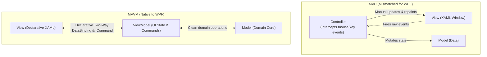
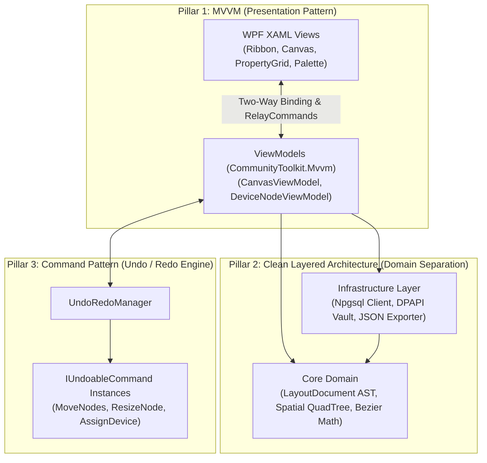
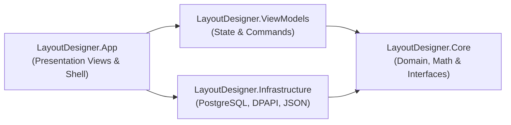
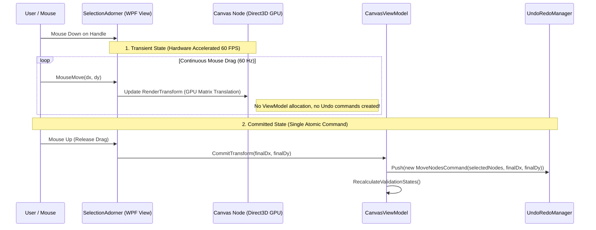
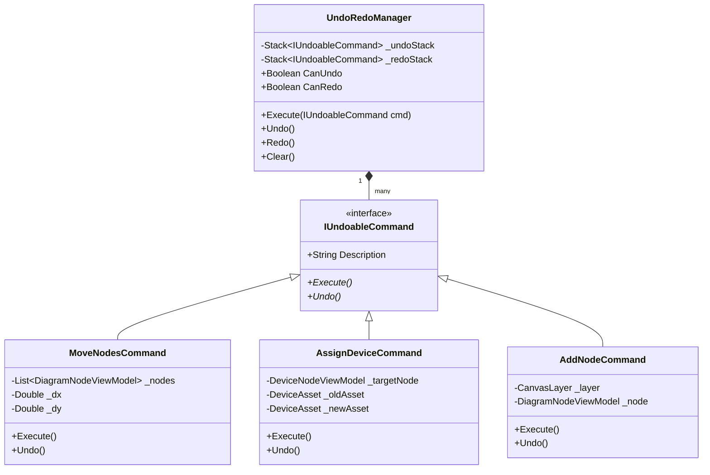
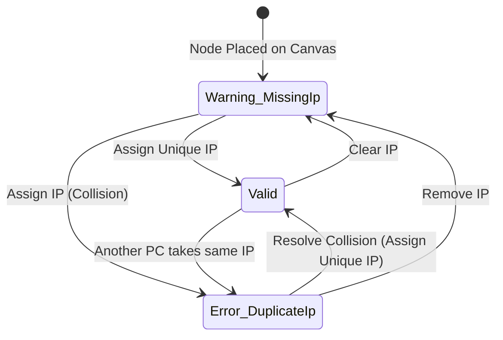

# Software Architecture & Engineering Guidelines
## Architectural Paradigm, Layering & Design Patterns for Enterprise Layout Designer
**Document Version:** 1.0.0  
**Target Platform:** Windows 10 / 11 (64-bit)  
**Framework:** .NET 8.0 / 9.0 (WPF, Self-Contained)  
**Standard Compliance:** ISO/IEC/IEEE 42010 Architecture Description Standard  

---

## 1. Paradigm Selection & Architectural Evaluation

### 1.1 Why MVVM and Why NOT MVC in WPF?
A foundational architectural question in desktop application engineering is the selection between **MVC (Model-View-Controller)** and **MVVM (Model-View-ViewModel)**. 

For a modern WPF desktop application, **MVC is anti-pattern**, while **MVVM is the native, intended architecture**:



| Evaluation Criteria | MVC (Model-View-Controller) | MVVM (Model-View-ViewModel) |
| :--- | :--- | :--- |
| **Origin & Intent** | Invented in 1979 for Smalltalk & web servers. The Controller manually repaints and updates the View. | **Invented by Microsoft in 2005 specifically for WPF/XAML** to leverage hardware-accelerated declarative binding. |
| **Data Synchronization** | **Manual & Brittle.** Requires writing verbose event handlers in code-behind (`.xaml.cs`) to sync UI textboxes with shapes. | **Automatic.** Two-way `{Binding PropertyName}` synchronizes properties instantly via `INotifyPropertyChanged`. |
| **Canvas & Inspector Sync** | Changing an IP in the PropertyGrid requires the Controller to search visual trees, calculate element tags, and trigger manual invalidation. | **Decoupled.** The PropertyGrid and the Canvas Node bind to the *same* `DeviceNodeViewModel`. Updating one automatically updates both. |
| **Unit Testability** | Extremely difficult. Testing controllers usually requires instantiating native Windows OS window handles (`HWND`). | **100% Headless Testability.** The entire canvas, drag-and-drop math, and IP collision validation can be tested without launching a window. |

---

## 2. The 3-Pillar Architectural Formula

To achieve a production-grade modeling tool like *Software Ideas Modeler*, pure MVVM alone is insufficient. The architecture combines three synergistic design patterns:



---

## 3. Clean Layered Architecture & Dependency Rules

The solution is decomposed into four discrete projects with strict inward-pointing dependencies:



### 3.1 Layer Responsibilities & Strict Boundaries

#### 1. `LayoutDesigner.Core` (The Domain Core)
* **Rule**: **Zero dependencies on WPF or UI namespaces** (`System.Windows`, `System.Windows.Controls`).
* **Contents**:
  - Pure domain data structures (`LayoutDocument`, `CanvasLayer`, `DeviceAsset`).
  - Mathematical engines (`BezierMath`, `SpatialQuadTree`, `SnappingEngine`).
  - Abstract contracts (`IDeviceRepository`, `IUndoableCommand`, `ILayoutExporter`, `ICredentialVault`).
* **Benefit**: Guaranteed fast execution, portable across platforms, completely unit-testable.

#### 2. `LayoutDesigner.Infrastructure` (Data, Security & I/O)
* **Rule**: Implements interfaces defined in `Core`. Never depends on `ViewModels` or `App`.
* **Contents**:
  - `PostgreSqlDeviceRepository`: Direct socket queries to `public.devices` via `Npgsql`.
  - `MockDeviceRepository`: In-memory asset provider for offline development without a database server.
  - `DpapiCredentialVault`: Hardware-encrypted storage of database credentials via Windows DPAPI.
  - `JsonLayoutExporter`: AST-to-JSON serialization engine targeting web consumers.

#### 3. `LayoutDesigner.ViewModels` (Presentation State & Business Logic)
* **Rule**: Uses `CommunityToolkit.Mvvm`. Manages all application state and user interactions.
* **Contents**:
  - `CanvasViewModel`: Viewport coordinates, zoom factor, selection lists, snapping invocations.
  - `DeviceNodeViewModel`: Hardware properties, visual bindings, and validation state machine.
  - `CanvasValidationEngine`: Evaluates unassigned IPs and duplicate IP collisions.
  - `UndoRedoManager`: 100-step transaction history stack.

#### 4. `LayoutDesigner.App` (WPF Visual Shell & Custom Controls)
* **Rule**: Declarative presentation only. Zero domain business logic in code-behind.
* **Contents**:
  - `MainWindow.xaml`: `Fluent.Ribbon` container and `AvalonDock` layout host.
  - `CanvasView.xaml`: Virtualized canvas surface with rulers and gridlines.
  - `Adorners/`: `SelectionAdorner` (8 resize handles, rotation grip) and `WarningBadgeAdorner` (`⚠️` / `⛔`).
  - `Assets/`: XAML vector resource dictionaries (`Stencils.xaml`, `Icons.xaml`).

---

## 4. State Management: The 60 FPS Canvas Duality

A critical architectural pitfall in naive MVVM diagramming tools is updating observable properties on the ViewModel during continuous mouse drag. Pushing 60 mouse movements per second through the data-binding and undo-history stack causes severe frame drops and stutter.

To solve this, the application implements the **Transient vs. Committed State Duality**:



1. **Transient State (In the View/Adorner Layer)**:
   * Handled directly by WPF’s hardware-accelerated transform pipeline (`RenderTransform = new MatrixTransform(...)`).
   * No ViewModel allocations or garbage collection churn during dragging.
2. **Committed State (In the ViewModel via Command)**:
   * Upon mouse button release (`MouseUp`), the final translation vector $(\Delta X, \Delta Y)$ is committed as a single, atomic `IUndoableCommand`.

---

## 5. The Command Pattern (Undo / Redo Engine)

All user mutations to the canvas execute via the **Command Pattern**:

```csharp
public interface IUndoableCommand
{
    string Description { get; }
    void Execute();
    void Undo();
}
```



---

## 6. Reactive Validation & Quality Assurance Pipeline

The system continuously enforces business invariants across all active canvas elements:



* **Invariant 1**: Any PC without an IP assigned enters `Warning_MissingIp` (displays amber `⚠️` badge and dashed border).
* **Invariant 2**: No two devices on the canvas may share the same `primary_ip`. Violations enter `Error_DuplicateIp` (displays bold red `⛔` badge and outline).
* **Hard Export Gatekeeper**:
  ```csharp
  public bool CanExport => !Nodes.OfType<DeviceNodeViewModel>()
                                 .Any(d => d.ValidationState == NodeValidationState.Error_DuplicateIp);
  ```
  The Ribbon "Export to Web JSON" command is **strictly disabled** while any duplicate IP collision exists.

---

## 7. Architectural Quality Metrics Summary

| Characteristic | Architectural Guarantee | Verification Method |
| :--- | :--- | :--- |
| **Maintainability** | Zero coupling between geometry math and visual XAML. | `LayoutDesigner.Core` compiles with 0 UI framework dependencies. |
| **Performance** | $60\text{ FPS}$ continuous canvas navigation. | Spatial QuadTree viewport culling + transient adorner transforms. |
| **Offline Reliability** | Zero runtime internet requirement. | Self-contained modular publication packaged into a single `Setup.exe`. |
| **Enterprise Security** | Sensitive database credentials protected on disk. | Windows DPAPI machine-scope encryption (`ProtectedData.Protect`). |
| **Data Integrity** | Multi-level Undo/Redo and collision-proof JSON export. | GoF Command Pattern stack + hard export validation blocking. |

---
*End of Architectural Specification.*
