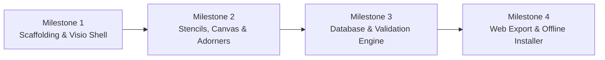

# Engineering Implementation Roadmap
## Milestone-Driven Execution Plan for Enterprise Layout Designer
**Document Version:** 1.0.0  
**Target Platform:** Windows 10 / 11 (64-bit)  
**Architecture:** .NET 8.0 / 9.0 (WPF, Self-Contained, MVVM, Clean Architecture)  

---

## 1. Roadmap Overview & Timeline Strategy

The project is structured into **four sequential, verified milestones**. Each milestone delivers a working, testable vertical slice of the application:

---

## 2. Milestone Breakdown & Technical Tasks

### 📍 Milestone 1: Project Scaffolding & Visio Shell Foundation
**Objective**: Establish the multi-project Clean Architecture solution, configure enterprise dependencies, and build the interactive Office/Visio window shell.

- [ ] **Task 1.1: Solution & Project Scaffolding**
  - Create `LayoutDesigner.sln` with 4 projects:
    - `LayoutDesigner.Core` (Class Library, .NET 8/9, zero UI dependencies)
    - `LayoutDesigner.Infrastructure` (Class Library, Npgsql, DPAPI, System.Text.Json)
    - `LayoutDesigner.ViewModels` (Class Library, CommunityToolkit.Mvvm)
    - `LayoutDesigner.App` (WPF Application, net8.0-windows / net9.0-windows)
  - Configure inward project references according to Clean Architecture rules.
- [ ] **Task 1.2: NuGet Package Integration**
  - Install verified community packages:
    - `Fluent.Ribbon` (Office-style ribbon window)
    - `Dirkster.AvalonDock` (Dockable, pinnable sidebars)
    - `CommunityToolkit.Mvvm` (Source-generated MVVM observable properties & commands)
    - `Npgsql` (PostgreSQL high-performance socket client)
    - `Extended.Wpf.Toolkit` (PropertyGrid inspector)
- [ ] **Task 1.3: Visio Ribbon Window Shell**
  - Construct `MainWindow.xaml` using `fluent:RibbonWindow`.
  - Implement Ribbon tabs:
    - **Home**: Select, Pan, Zoom to 100%, Fit to Window, Toggle Grid.
    - **Insert**: Text Label, Background Blueprint Image.
    - **Layout**: Align (Left, Center, Right), Distribute, Z-Index (Bring Forward, Send Backward).
    - **Database**: Connection Settings, Sync Inventory.
  - Implement AvalonDock layout with 3 dockable anchors:
    - Left Dock: Stencils Palette
    - Center Dock: Interactive Canvas
    - Right Dock: Properties Inspector
- [ ] **Task 1.4: Viewport Navigation Engine**
  - Implement `CanvasView.xaml` with high-performance `ScrollViewer`.
  - Add continuous zoom centered on mouse cursor ($10\%$ to $1000\%$).
  - Add middle-mouse button and `Space + Left Drag` panning.
  - Implement dynamic Cartesian grid rendering (Dots / Lines) with auto-scaling.
- [ ] **Task 1.5: Metric & Pixel Rulers**
  - Build top and left ruler controls tracking cursor coordinates $(X, Y)$ in real time.

**Milestone 1 Quality Gate (Definition of Done)**:
* Application compiles and launches in $< 0.5\text{s}$.
* Ribbon tabs switch smoothly.
* Docking panels can be pinned, unpinned, and floated.
* Canvas zooms and pans with $60\text{ FPS}$ hardware acceleration.

---

### 📍 Milestone 2: Stencils, Drag-and-Drop & Transform Adorners
**Objective**: Implement the vector stencil catalog, seamless drag-and-drop instantiation, and interactive 8-point resize/rotate bounding box handles.

- [ ] **Task 2.1: Vector Stencil Resource Dictionary & Shape Taxonomy**
  - Build `Stencils.xaml` and `Icons.xaml` containing standardized $100 \times 100$ top-down vector definitions:
    - *Hardware*: Desktop PC, Laptop, Monitor, Server Rack.
    - *Furniture*: Office Swivel Chair, Standard Desk, Conference Table, 2-Seater Sofa.
    - *Shapes (Full Set)*: Circle, Rectangle, Rounded Rectangle, Triangle, Rounded Corner Triangle, Semicircle, Line, Bezier, and Donut.
- [ ] **Task 2.2: Stencils Palette UI**
  - Build `StencilPaletteView.xaml` with categorized, collapsible `Expander` groups.
  - Add instant real-time search filter box.
- [ ] **Task 2.3: Native Drag-and-Drop Pipeline**
  - Wire WPF `DragDrop.DoDragDrop` on palette items.
  - Handle `DragOver` (preview shadow) and `Drop` events on the Canvas.
  - Implement coordinate conversion: Screen pixels $\rightarrow$ World canvas floating-point $(X, Y)$ with automatic snap-to-grid.
  - Enforce device-only naming: Only devices display text names below the icon; furniture, groups, and shapes never display names on the layout.
- [ ] **Task 2.4: Selection & Transform Adorners with Roundness Handles**
  - Implement `SelectionAdorner.cs` rendering 8 resize thumbs, rotation grip, and dashed outline.
  - Implement `CornerRadiusHandleAdorner.cs`: projects interactive corner handles on `rounded_rectangle` and `rounded_corner_triangle` (drags inward to round, outward to sharpen).
  - Implement `DonutInnerRadiusAdorner.cs`: projects radial handle on inner hole circumference of `donut` shapes.
- [ ] **Task 2.5: Bezier Curve Control Handles**
  - Implement `BezierHandleAdorner.cs` for curved walls, exposing interactive tangent anchor handles.
- [ ] **Task 2.6: Grouping (Ctrl+G / Ctrl+Shift+G) & Undo/Redo Engine**
  - Implement grouping commands: `GroupSelectedNodesCommand` (`Ctrl+G`) and `UngroupNodesCommand` (`Ctrl+Shift+G`).
  - Groups preserve a configurable `name` in the Properties panel and schema, but group boundaries/names are not shown on the layout.
  - Implement `UndoRedoManager` supporting 100 history states across all operations (Move, Resize, Group, Ungroup, Delete).

**Milestone 2 Quality Gate (Definition of Done)**:
* Stencils can be dragged from the palette and dropped onto the canvas.
* Selected items show 8 resize handles and a rotation grip.
* Holding `Shift` constrains aspect ratio; holding `Alt` anchors center.
* Full undo and redo of transformations, creations, and deletions works without visual artifacts.

---

### 📍 Milestone 3: Database Integration, Device Binding & Validation Engine
**Objective**: Connect directly to PostgreSQL `public.devices`, build the property inspector, and enforce continuous missing IP warnings and duplicate IP error states.

- [ ] **Task 3.1: Data Access Layer & Repository Pattern**
  - Implement `IDeviceRepository` with:
    - `PostgreSqlDeviceRepository`: Queries `public.devices` (`device_id`, `display_name`, `primary_ip`, `mac_address`) over raw TCP sockets via `Npgsql`.
    - `MockDeviceRepository`: Supplies 25 simulated lab workstations for offline development without a running server.
- [ ] **Task 3.2: Database Connection Modal & Live Diagnostics**
  - Build `DatabaseSettingsDialog.xaml` (Host, Port, DB, User, Password).
  - Implement asynchronous **"Test Connection"** diagnostic:
    - Measures round-trip socket latency in ms.
    - Validates credentials and fetches PostgreSQL version.
    - Verifies `public.devices` table existence.
- [ ] **Task 3.3: DPAPI Encrypted Storage**
  - Implement `DpapiCredentialVault.cs` encrypting connection profiles via Windows DPAPI into `%ProgramData%\EnterpriseLayoutDesigner\db_settings.dat`.
- [ ] **Task 3.4: Property Inspector Binding**
  - Integrate `Extended.Wpf.Toolkit.PropertyGrid` in `PropertyInspectorView.xaml`.
  - For geometric shapes: inspect/edit $X, Y, W, H$, Rotation, Fill, Stroke.
  - For PC devices: provide searchable autocomplete dropdown populated from `public.devices`.
- [ ] **Task 3.5: Continuous Missing IP Warning Engine (`⚠️`)**
  - Implement `NodeValidationState.Warning_MissingIp` for PC nodes lacking an IP.
  - Draw amber warning badge and dashed amber outline around unassigned PCs.
  - Add status bar live counter: `⚠️ [X] Unassigned PCs`. Clicking it navigates to the next unassigned PC.
- [ ] **Task 3.6: Duplicate IP Conflict Error Engine (`⛔`)**
  - Implement reactive collision detection in `CanvasValidationEngine`:
    - If 2+ devices share the same `primary_ip`, both switch immediately to `NodeValidationState.Error_DuplicateIp`.
    - Render bold red outline (`#EF4444`) and red alert badge.
    - Display prominent red status bar alert: `❌ IP Conflict Detected ([IP])`.
    - Automatically filter or flag already-assigned devices in the Property Inspector dropdown.

**Milestone 3 Quality Gate (Definition of Done)**:
* Database connection test connects to PostgreSQL, displays latency, and verifies `public.devices`.
* Dragging a PC defaults to unassigned with an amber `⚠️` warning.
* Assigning a device links `display_name` and `primary_ip` and clears the warning.
* Assigning an already-used IP immediately triggers the red `⛔` conflict state on both machines.

---

### 📍 Milestone 4: Web JSON Interchange, Export Gatekeeper & Offline Packaging
**Objective**: Export lossless JSON ASTs for third-party web apps, verify with a sample HTML5 web viewer, and build the single-file offline admin setup installer.

- [ ] **Task 4.1: Web JSON Exporter (`JsonLayoutExporter`)**
  - Implement serialization emitting standard normalized JSON:
    - Viewport metadata (Width, Height, Units, GridSize).
    - Layer hierarchy.
    - Geometric shapes with standardized SVG `d="..."` path strings.
    - Computer devices with `deviceId`, `displayName`, `primaryIp`, and position.
- [ ] **Task 4.2: Export Gatekeeper & Validation Blocker**
  - Wire `CanExport => !HasDuplicateIpErrors`.
  - If duplicate IP errors exist: Ribbon Export button is **disabled** with an error banner.
  - If unassigned PCs exist: clicking Export prompts a confirmation dialog alerting the user before proceeding.
- [ ] **Task 4.3: Sample Downstream HTML5 Web Viewer**
  - Create a lightweight `web-viewer/index.html` ($< 100$ lines of vanilla JS) reading the exported JSON and rendering the exact floor plan using `<svg>` or `<canvas>`.
  - Demonstrates proof of concept for downstream web developers.
- [ ] **Task 4.4: Self-Contained Release Build Pipeline**
  - Configure `dotnet publish` for `win-x64` (`--self-contained true`).
  - Verify that the output folder in `dist/publish/` contains all runtimes, DLLs, and assets.
- [ ] **Task 4.5: Inno Setup Single-File Installer (`installer.iss`)**
  - Create Inno Setup script packing `dist/publish/` into `LayoutDesigner-Setup-v1.0.0.exe`.
  - Enforce `PrivilegesRequired=admin` (UAC prompt).
  - Install to `%ProgramFiles%\EnterpriseLayoutDesigner`.
  - Register `.layout` file associations, Desktop icon, and Start Menu shortcuts.
  - Verify 100% offline installation on a clean Windows machine with zero network access.

**Milestone 4 Quality Gate (Definition of Done)**:
* Clicking "Export to Web JSON" produces a clean, compliant JSON file.
* The sample HTML5 web viewer renders the exact floor plan with matching coordinates and labels.
* Running `LayoutDesigner-Setup-v1.0.0.exe` installs cleanly with administrator privileges without needing internet access.

---

## 3. Progress Tracking Matrix

| Milestone | Scope | Status | Target Delivery |
| :--- | :--- | :--- | :--- |
| **Milestone 1** | Scaffolding, Visio Ribbon Shell & Zoom/Pan Canvas | ⏳ Ready to Start | Week 1 |
| **Milestone 2** | Stencils Palette, Drag-and-Drop & Transform Adorners | 📋 Planned | Week 2 |
| **Milestone 3** | PostgreSQL Integration, Device Link & Validation Engine | 📋 Planned | Week 3 |
| **Milestone 4** | Web JSON Exporter, Sample Web Viewer & Offline Installer | 📋 Planned | Week 4 |

---
*End of Implementation Roadmap.*
