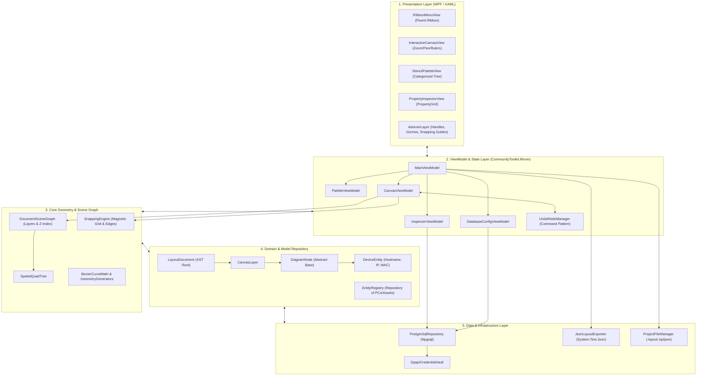
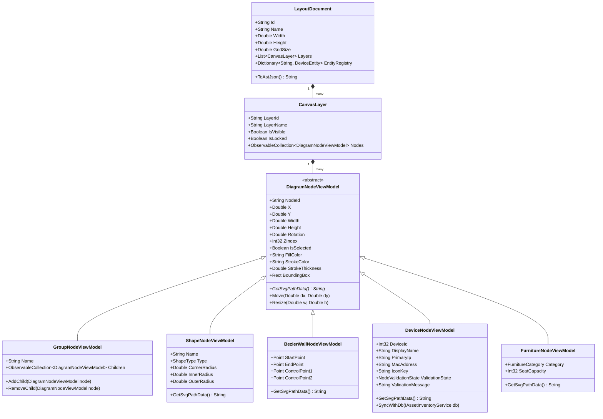
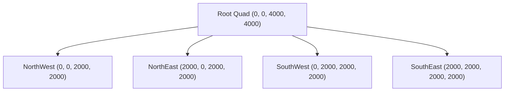
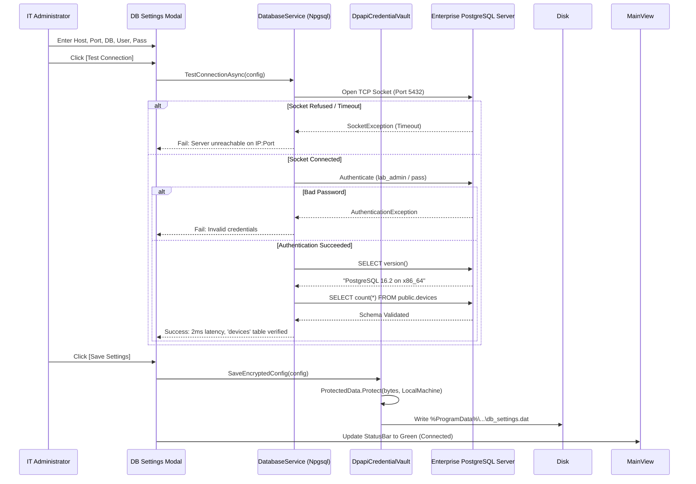
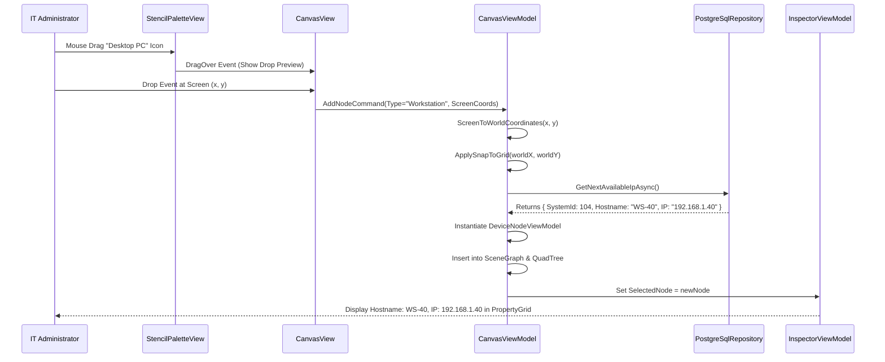
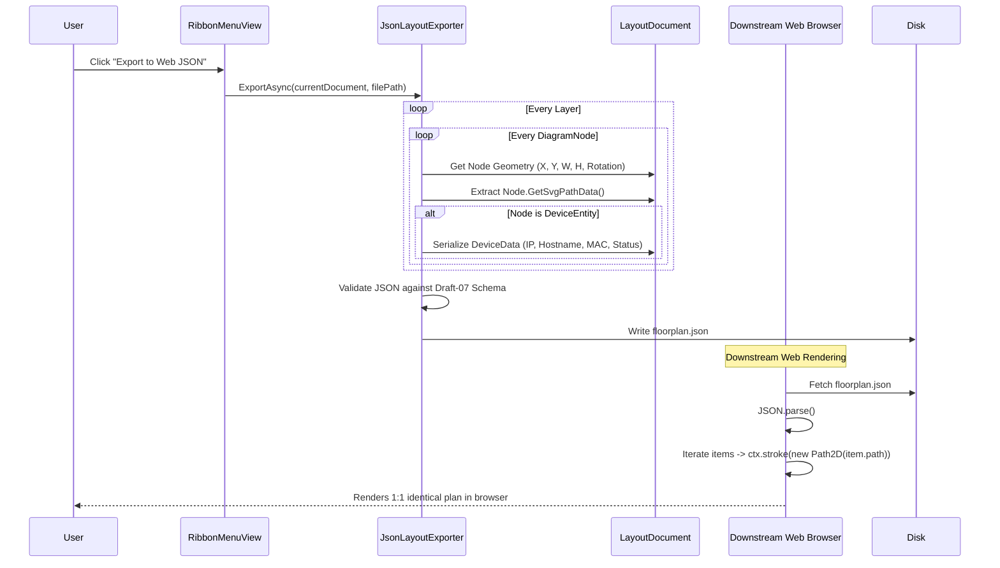

# Software Design Document (SDD)
## Architecture & Technical Design Specification for Enterprise Layout Designer
**Document Version:** 1.0.0  
**Target Platform:** Windows 10 / 11 (64-bit)  
**Framework:** .NET 8.0 / 9.0 (WPF, Self-Contained)  
**Standard Compliance:** IEEE 1016-2009 Standard for Information Technology — Systems Design  

---

## 1. System Overview & Architectural Drivers

### 1.1 Purpose
This Software Design Document (SDD) translates the requirements defined in the SRS (v1.1.0) into a concrete, production-ready technical architecture. It details class structures, MVVM state management, spatial indexing algorithms, database DDL schemas, rendering optimizations, and dynamic interaction sequences.

### 1.2 Architectural Drivers & Quality Attributes

| Driver | Architectural Strategy | Metric / Guarantee |
| :--- | :--- | :--- |
| **Air-Gapped Isolation** | Self-contained compilation (`--self-contained true`), raw socket DB calls (`Npgsql`), embedded SVG assets (`.qrc` or XAML resource dictionaries). | Zero external HTTP/HTTPS calls. No runtime download prompts. |
| **60 FPS Vector Performance** | Spatial QuadTree indexing, Viewport Culling, geometry freezing (`Freezable.Freeze()`), and lightweight `StreamGeometry` paths. | Sustains $\ge 60\text{ FPS}$ with 2,500+ active nodes on canvas. |
| **Separation of Concerns** | MVVM via `CommunityToolkit.Mvvm`, Clean Architecture layering, decoupled Model Entities vs. Canvas Visual Nodes. | Zero business logic in XAML Code-Behind. Full testability of ViewModels. |
| **Enterprise Security** | Windows Data Protection API (DPAPI) machine/user scope encryption for DB secrets. | Zero plaintext passwords on disk. |
| **Downstream Web Interop** | Standardized coordinate normalization and SVG Path notation (`d="..."`) in JSON export. | Less than 100 lines of standard JS needed for web app rendering. |

---

## 2. High-Level System Architecture

The application adopts a **Layered Clean Architecture** combined with the **Model-View-ViewModel (MVVM)** pattern for UI presentation:



---

## 3. Subsystem & Component Design

### 3.1 Domain Model & Scene Graph

Every item on the canvas is represented in an in-memory Abstract Syntax Tree (AST):



---

### 3.2 The Adorner & Transform Engine

To prevent polluting shapes with visual handle logic, WPF’s native `AdornerLayer` is leveraged:

```csharp
public class SelectionAdorner : Adorner
{
    private readonly VisualCollection _visuals;
    private readonly Thumb _topLeft, _topRight, _bottomLeft, _bottomRight;
    private readonly Thumb _topMid, _bottomMid, _leftMid, _rightMid;
    private readonly Thumb _rotationThumb;
    private readonly DiagramNodeViewModel _node;

    public SelectionAdorner(UIElement adornedElement, DiagramNodeViewModel node) 
        : base(adornedElement)
    {
        _node = node;
        _visuals = new VisualCollection(this);

        // Instantiate standard 8 resize thumbs
        _topLeft = CreateThumb(Cursors.SizeNWSE, OnResizeTopLeft);
        _topRight = CreateThumb(Cursors.SizeNESW, OnResizeTopRight);
        _bottomLeft = CreateThumb(Cursors.SizeNESW, OnResizeBottomLeft);
        _bottomRight = CreateThumb(Cursors.SizeNWSE, OnResizeBottomRight);
        // ... additional edge thumbs ...

        // Instantiate rotation thumb (offset 25px above top-center)
        _rotationThumb = CreateThumb(Cursors.Hand, OnRotate);
    }

    protected override void OnRender(DrawingContext dc)
    {
        var rect = new Rect(new Point(0, 0), AdornedElement.RenderSize);
        var pen = new Pen(new SolidColorBrush(Color.FromRgb(0, 120, 215)), 1.5)
        {
            DashStyle = DashStyles.Dash
        };
        dc.DrawRectangle(null, pen, rect);

        // Draw line connecting top-center to rotation thumb
        dc.DrawLine(pen, new Point(rect.Width / 2, 0), new Point(rect.Width / 2, -25));
    }
}
```

#### 3.2.1 Continuous Validation State Machine (Warning & Conflict Error States)

Every device node on the canvas evaluates a 3-tier validation state:

```csharp
public enum NodeValidationState
{
    Valid,                 // IP assigned and unique across the canvas
    Warning_MissingIp,     // PC placed but no primary_ip assigned
    Error_DuplicateIp      // Two or more PCs share the same primary_ip
}
```

* **Validation Trigger**: Evaluated reactively across all nodes whenever a node is added, removed, or has its `PrimaryIp` modified (`CanvasViewModel.RecalculateValidationStates()`).
* **Visual States**:
  1. **Warning State (`Warning_MissingIp`)**:
     - *Badge*: Amber warning triangle (`⚠️`) at $(X + W - 6, Y - 6)$.
     - *Stroke*: Amber dashed border (`#F59E0B`).
     - *Tooltip*: *"Warning: Workstation has no IP assigned."*
  2. **Error State (`Error_DuplicateIp`)**:
     - *Badge*: High-priority red stop badge (`⛔`) with red glow.
     - *Stroke*: Bold red border (`#EF4444`, 2.5px width).
     - *Tooltip*: *"Error: Duplicate IP Conflict! Multiple workstations share this IP."*
* **Status Bar Integration**:
  - Displays: `❌ [X] IP Conflicts Detected` (Red) or `⚠️ [Y] Unassigned PCs` (Amber).
  - Clicking automatically centers and selects the offending nodes.
* **Export Gatekeeper (`CanExport`)**:
  - `CanvasViewModel.CanExport => !HasDuplicateIpErrors;`
  - While any `Error_DuplicateIp` exists, the "Export to Web JSON" command is **strictly disabled**, preventing corrupted network topologies from downstream deployment.

---

### 3.3 Spatial QuadTree for High-Performance Culling

To maintain $\ge 60\text{ FPS}$ during viewport panning and zooming across thousands of elements, the engine organizes nodes into an in-memory **Spatial QuadTree**:



```csharp
public class QuadTree<T> where T : class
{
    private readonly int _maxObjects = 10;
    private readonly int _maxLevels = 5;
    private readonly int _level;
    private readonly Rect _bounds;
    private readonly List<QuadItem<T>> _items = new();
    private QuadTree<T>[]? _subNodes;

    public QuadTree(int level, Rect bounds)
    {
        _level = level;
        _bounds = bounds;
    }

    public void Insert(T item, Rect itemBounds)
    {
        if (_subNodes != null)
        {
            int index = GetSubNodeIndex(itemBounds);
            if (index != -1)
            {
                _subNodes[index].Insert(item, itemBounds);
                return;
            }
        }

        _items.Add(new QuadItem<T>(item, itemBounds));

        if (_items.Count > _maxObjects && _level < _maxLevels)
        {
            if (_subNodes == null) Split();
            // Re-distribute existing items into child quadrants
        }
    }

    public List<T> Query(Rect viewportBounds)
    {
        var results = new List<T>();
        QueryInternal(viewportBounds, results);
        return results;
    }
}
```

---

### 3.4 Multi-Level Undo/Redo Engine (Command Pattern)

Every operation modifying state implements `IUndoableCommand`:

```csharp
public interface IUndoableCommand
{
    string Description { get; }
    void Execute();
    void Undo();
}

public class MoveNodesCommand : IUndoableCommand
{
    private readonly List<DiagramNodeViewModel> _nodes;
    private readonly double _deltaX;
    private readonly double _deltaY;

    public MoveNodesCommand(IEnumerable<DiagramNodeViewModel> nodes, double dx, double dy)
    {
        _nodes = nodes.ToList();
        _deltaX = dx;
        _deltaY = dy;
    }

    public string Description => $"Move {_nodes.Count} elements";
    public void Execute() => _nodes.ForEach(n => n.Move(_deltaX, _deltaY));
    public void Undo() => _nodes.ForEach(n => n.Move(-_deltaX, -_deltaY));
}
```

---

## 4. Enterprise PostgreSQL Integration & Data Architecture

### 4.1 Enterprise Database DDL & Read Model (PostgreSQL)

Per the companion application's schema in `public`, the Layout Designer connects in read/bind mode specifically to the `public.devices` table to extract device identities:

```sql
-- Companion Schema Reference: public.devices
-- The Layout Designer reads from this table:
SELECT 
    device_id,
    display_name,
    primary_ip,
    mac_address
FROM public.devices
ORDER BY display_name ASC;
```

#### C# Device Entity Model
```csharp
public class DeviceAsset
{
    public int DeviceId { get; set; }
    public string DisplayName { get; set; } = string.Empty;
    public string PrimaryIp { get; set; } = string.Empty;
    public string? MacAddress { get; set; }
}
```

---

### 4.2 Database Service & Secure DPAPI Storage Architecture



---

## 5. Interaction Sequences

### 5.1 Drag-and-Drop Stencil & IP Auto-Allocation



---

### 5.2 JSON Serialization & Web Interchange Pipeline



---

## 6. Project Solution Structure (.NET 8/9 Solution)

The solution is organized into modular projects adhering strictly to Clean Architecture principles:

```text
EnterpriseLayoutDesigner/
│
├── src/
│   ├── LayoutDesigner.App/                   # WPF Executable (Views, App.xaml, Shell)
│   │   ├── Views/
│   │   │   ├── MainWindow.xaml               # Ribbon + Docking Host
│   │   │   ├── CanvasView.xaml               # Interactive Zoom/Pan Canvas
│   │   │   ├── StencilPaletteView.xaml       # Category Accordion
│   │   │   ├── PropertyInspectorView.xaml    # PropertyGrid Inspector
│   │   │   └── DatabaseSettingsDialog.xaml   # DB Config & Test Dialog
│   │   ├── Adorners/
│   │   │   ├── SelectionAdorner.cs           # 8 Thumbs + Rotation Grip
│   │   │   └── BezierHandleAdorner.cs        # Tangent Handles for Curves
│   │   ├── Assets/
│   │   │   └── Stencils.xaml                 # Vector Path Resource Dictionary
│   │   └── App.xaml
│   │
│   ├── LayoutDesigner.ViewModels/            # MVVM State & Commands
│   │   ├── MainViewModel.cs
│   │   ├── CanvasViewModel.cs
│   │   ├── StencilPaletteViewModel.cs
│   │   ├── PropertyInspectorViewModel.cs
│   │   └── DatabaseSettingsViewModel.cs
│   │
│   ├── LayoutDesigner.Core/                  # Pure Business Logic & Math
│   │   ├── Models/
│   │   │   ├── LayoutDocument.cs             # AST Root
│   │   │   ├── CanvasLayer.cs
│   │   │   └── DeviceEntity.cs
│   │   ├── Geometry/
│   │   │   ├── BezierMath.cs
│   │   │   ├── QuadTree.cs                   # Spatial Index
│   │   │   └── SnappingEngine.cs
│   │   └── Commands/
│   │       ├── IUndoableCommand.cs
│   │       └── UndoRedoManager.cs
│   │
│   └── LayoutDesigner.Infrastructure/        # IO, Database & Cryptography
│       ├── Database/
│       │   ├── PostgreSqlRepository.cs       # Npgsql Connection Pool
│       │   └── DpapiCredentialVault.cs       # Windows DPAPI Security
│       └── Serialization/
│           ├── JsonLayoutExporter.cs         # Web Interchange JSON
│           └── PackageFileService.cs         # .layout Zip Packager
│
├── build/
│   └── installer.iss                         # Inno Setup Offline Script
│
└── tests/
    ├── LayoutDesigner.Core.Tests/            # QuadTree, Snapping & AST Unit Tests
    └── LayoutDesigner.Infrastructure.Tests/  # Serialization & DB Mock Tests
```

---

## 7. Packaging & Zero-Network Offline Installation Design

### 7.1 Self-Contained Multi-File Publication
The compilation process outputs a standard modular Windows application structure (avoiding single-file unpacking latency and antivirus temp heuristics):

```powershell
dotnet publish src/LayoutDesigner.App/LayoutDesigner.App.csproj `
    -c Release `
    -r win-x64 `
    --self-contained true `
    -o dist/publish
```

#### Output Directory Structure (`dist/publish/`):
```text
dist/publish/
├── LayoutDesigner.exe           # Primary Application Launcher
├── LayoutDesigner.dll           # Application Managed Assembly
├── Npgsql.dll                   # PostgreSQL Driver
├── Fluent.Ribbon.dll            # Ribbon Component Assembly
├── Dirkster.AvalonDock.dll      # Docking Framework
├── coreclr.dll, clrjit.dll      # Bundled .NET 8/9 Runtime Core
├── wpfgfx_cor3.dll              # Hardware Direct3D Render Engine
├── Assets/                      # Local Vector Stencils & Icons
└── runtimes/                    # Architecture-Specific Native Libraries
```

### 7.2 Single-File Setup Generation (Inno Setup)
The Inno Setup compiler (`ISCC.exe`) packages the entire `dist/publish/` folder into a single standalone installer:
* **Output**: `LayoutDesigner-Setup-v1.0.0.exe` (a single `.exe` file for distribution).
* **Target Installation**: Extracts files into `%ProgramFiles%\EnterpriseLayoutDesigner\` with full administrative rights.
* **Launch Performance**: Instant cold-start ($< 0.5\text{s}$) because assemblies reside natively on the file system without temporary runtime extraction.

---
*End of Design Document.*
