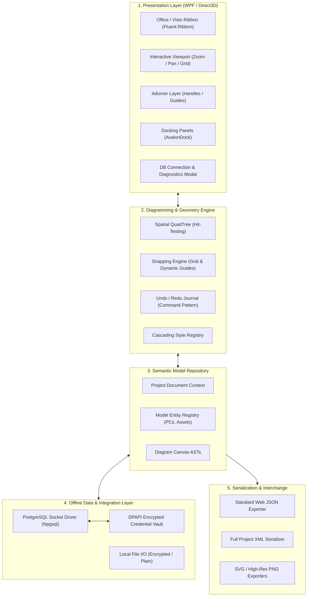
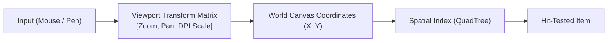
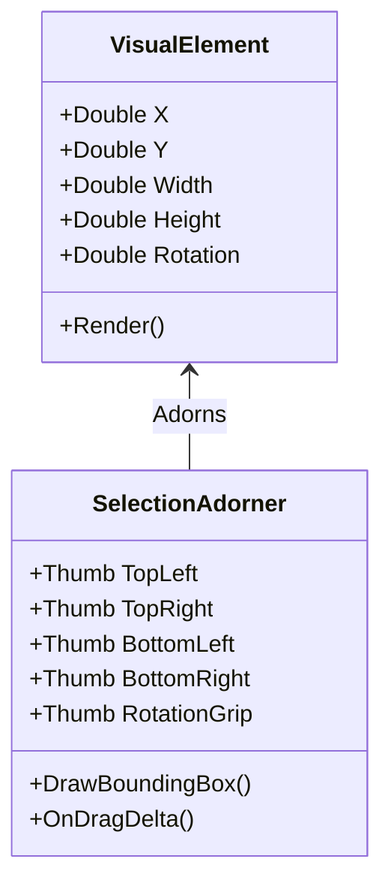
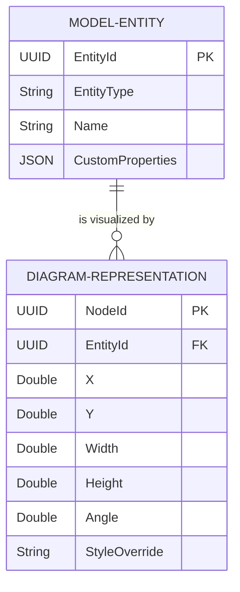

# Software Requirements Specification (SRS)
## Reverse-Engineered Architecture & Functional Specification of Software Ideas Modeler
**Document Version:** 1.1.0  
**Target Architecture:** Desktop Vector Diagramming & Modeling Engine (.NET / WPF)  
**Standard Compliance:** IEEE 830-1998 Format  

---

## 1. Introduction

### 1.1 Purpose
The purpose of this document is to provide a complete, industry-grade Software Requirements Specification (SRS) analyzing the core architecture, functional capabilities, user interactions, and engineering mechanisms of **Software Ideas Modeler (SIM)**. This specification serves as the formal architectural reference and design blueprint for building an offline, enterprise-grade layout and floor plan designer in .NET/WPF.

### 1.2 Scope of the System
Software Ideas Modeler is a lightweight, high-performance CASE (Computer-Aided Software Engineering) and diagramming software. Unlike general-purpose vector drawing tools (such as Illustrator or Inkscape), SIM is fundamentally a **model-driven diagramming platform**. 

The key distinction lies in the decoupling of **Entities (Model)** and **Visual Shapes (Presentation)**:
* A device, room, or element exists as an independent entity in a project repository with semantic metadata (e.g., Hostname, IP address, MAC, manufacturer).
* A visual node on the drawing canvas is a projection/instance of that entity.
* The system provides a unified canvas with CAD-like snapping, parametric shapes, bezier curve paths, hierarchical grouping, dockable tool windows, property inspectors, and lossless data interchange (XML/JSON/SVG).

### 1.3 Definitions, Acronyms, and Abbreviations
* **AST**: Abstract Syntax Tree. The structured hierarchy describing the document layout.
* **Adorner**: A specialized UI layer rendered directly above elements to provide handles (resizing, rotating, connection terminals) without mutating the underlying geometry.
* **Bounding Box**: The minimum enclosing rectangle $(X, Y, \text{Width}, \text{Height})$ of an element.
* **CASE**: Computer-Aided Software Engineering.
* **DPAPI**: Windows Data Protection API (`System.Security.Cryptography.ProtectedData`).
* **Orthographic Projection**: A 2D overhead camera projection where parallel lines never converge (top-down blueprint mode).
* **Parametric Shape**: A procedural shape whose geometry adapts dynamically to numeric properties (e.g., a table that recalculates its bounds and distributed chairs when `SeatCount` changes).
* **UAC**: User Account Control (Windows administrator elevation prompt).
* **WAL**: Write-Ahead-Log for crash recovery.
* **Z-Index**: The stacking order of elements determining rendering occlusion.

---

## 2. Overall Description

### 2.1 Product Perspective & Architectural Decomposition
Software Ideas Modeler is structured around five decoupled subsystems:



### 2.2 User Classes and Operating Personas
* **Infrastructure Architect / IT Administrator**: Designs physical computer lab layouts, configures database endpoints, reserves IP blocks, allocates hostnames to physical locations, verifies network reachability.
* **Enterprise Facility Planner**: Arranges furniture, partition walls, emergency pathways, conference spaces, and structural boundaries.
* **Downstream Web Developer**: Consumes the exported JSON/XML artifact and renders an identical, read-only or telemetry-enriched plan inside a web application.

### 2.3 Operating Environment
* **Platform**: Microsoft Windows 10 / Windows 11 (64-bit).
* **Framework**: .NET 8.0 / .NET 9.0 Desktop Runtime (Self-Contained).
* **Rendering Subsystem**: Hardware-accelerated Direct3D / WPF vector pipeline.
* **Connectivity**: 100% Offline / Air-Gapped. Local TCP socket connections to enterprise LAN PostgreSQL instances. Zero external telemetry or CDN calls.

### 2.4 Deployment & Packaging Constraints
* **CON-DEP-01: Single-File Setup Executable**: The installer shall be distributed as a single standalone setup executable (`Setup.exe`) or Windows Installer package (`.msi`).
* **CON-DEP-02: Standard Modular File Extraction**: When executed with local administrator privileges, the setup installer shall extract into a standard Windows application folder (`%ProgramFiles%\EnterpriseLayoutDesigner`) containing the primary executable (`LayoutDesigner.exe`), native runtime DLLs, dependency assemblies, and asset directories (avoiding single-file temp extraction overhead and ensuring fast startup times).
* **CON-DEP-03: Self-Contained Offline Runtime**: The installer shall bundle the complete .NET runtime and WPF libraries (`--self-contained true`), requiring zero pre-installed runtimes and zero network access during installation or execution.
* **CON-DEP-04: Administrator Privilege Enforcement**: The installer shall explicitly request local administrator elevation (`PrivilegesRequired=admin` / UAC prompt) to write to `%ProgramFiles%` and register local `.layout` file associations.

---

## 3. Detailed Functional Requirements

### 3.1 The Diagram Canvas & Viewport Subsystem



#### FR-CAN-01: Coordinate Spaces & Transformation
* **FR-CAN-01.1**: The canvas shall maintain two independent coordinate systems:
  1. *Screen Coordinates*: Integer pixel positions relative to the physical monitor window.
  2. *World Coordinates*: Double-precision floating-point coordinates $(X, Y)$ representing real-world canvas units (millimeters, meters, or blueprint points).
* **FR-CAN-01.2**: The viewport shall support smooth continuous zooming from $10\%$ to $1000\%$ centered on the cursor position via `Ctrl + MouseWheel`.
* **FR-CAN-01.3**: The viewport shall support high-performance panning via `Middle Mouse Drag` or `Spacebar + Left Click Drag`.

#### FR-CAN-02: Grid & Ruler System
* **FR-CAN-02.1**: The canvas shall render an adaptive Cartesian grid supporting:
  - Dot matrix grid.
  - Subdivided line grid (Major / Minor gridlines).
* **FR-CAN-02.2**: The grid shall adapt dynamically across zoom thresholds to prevent visual moiré patterns.
* **FR-CAN-02.3**: Horizontal and vertical rulers shall pin to the top and left viewport borders, tracking cursor position with real-time indicator lines.

#### FR-CAN-03: Spatial Indexing & Hit Testing
* **FR-CAN-03.1**: The canvas engine shall maintain a **Spatial QuadTree** indexing all element bounding boxes.
* **FR-CAN-03.2**: Mouse click and marquee selection hit-testing shall execute in $O(\log N)$ time, maintaining $\ge 60\text{ FPS}$ with $\ge 2,500$ elements loaded.

---

### 3.2 Shape, Path, and Geometry Manipulation

#### FR-GEO-01: Geometric Primitives & Shape Taxonomy
The engine shall provide native mathematical definitions and SVG path generators for:
* **Circle**: Diameter $2R$, uniform scaling.
* **Rectangle**: Configurable $X, Y, W, H$.
* **Rounded Rectangle**: Configurable $X, Y, W, H$, and `CornerRadius` (controllable via Properties panel & canvas handle).
* **Triangle**: 3-point polygon.
* **Rounded Corner Triangle**: 3-point polygon with chamfered/arc-blended vertices governed by `CornerRadius` (controllable via Properties panel & canvas handle).
* **Semicircle**: Flat base with arc sweep.
* **Line**: Linear segment between two endpoints $[X_1, Y_1]$ and $[X_2, Y_2]$.
* **Bezier Curve**: Cubic curve defined by $[X_0, Y_0]$, $[C_{1x}, C_{1y}]$, $[C_{2x}, C_{2y}]$, and $[X_1, Y_1]$ with interactive tangent handles.
* **Donut**: Concentric ring with outer radius $R_o$ and configurable inner hole radius $R_i$ (controllable via Properties panel & canvas radial handle).

#### FR-GEO-05: Grouping Hierarchy & Selective Labeling
* **FR-GEO-05.1: Grouping Shortcuts**: Users shall be able to group selected items with `Ctrl + G` and ungroup with `Ctrl + Shift + G`.
* **FR-GEO-05.2: Group Concealment**: Each group shall possess a configurable `name` in the Properties panel and exported schema, but group boundaries and names shall **not** be rendered as visual text on the layout canvas.
* **FR-GEO-05.3: Device-Only Labeling Invariant**: Only `device` items shall display their name (and optional IP) directly below the icon on the canvas layout. Furniture, groups, and basic shapes shall **never** render text labels on the layout canvas.
* **FR-GEO-05.4: 3D Positioning (`x, y, z`)**: Every item regardless of type shall maintain explicit $X, Y$ coordinates and an integer $Z$ layer depth (stacking order).

#### FR-GEO-06: Interactive Canvas Control Handles for Roundness & Donuts
* **FR-GEO-06.1**: Selecting a `rounded_rectangle` or `rounded_corner_triangle` shall project a dedicated corner radius handle adorner inside the vertex. Dragging this handle dynamically adjusts `CornerRadius` in real-time.
* **FR-GEO-06.2**: Selecting a `donut` shall project a radial inner radius handle on the inner circumference, adjusting hole size dynamically.

#### FR-GEO-02: Selection & The Adorner Layer



* **FR-GEO-02.1**: When an element is selected, a `SelectionAdorner` shall project above the element rendering:
  - 8 resize handles (4 corners, 4 midpoints).
  - 1 rotation thumb offset above the top-center handle.
  - Bounding rectangle border with dashed highlight.
* **FR-GEO-02.2**: Holding `Shift` while dragging corner handles shall constrain the aspect ratio $(W/H = K)$.
* **FR-GEO-02.3**: Holding `Alt` while resizing shall anchor the center point of the shape.
* **FR-GEO-02.4**: Dragging the rotation thumb shall rotate the element around its origin point $(0.5, 0.5)$, with automatic $15^\circ$ angle snapping when holding `Shift`.

#### FR-GEO-03: Bezier Curve Path Editing
* **FR-GEO-03.1**: Entering "Path Edit Mode" (Double-click or `F2`) on a curved element shall reveal control point tangent handles.
* **FR-GEO-03.2**: Users shall be able to drag control handles to manipulate curve curvature dynamically.
* **FR-GEO-03.3**: The engine shall serialize bezier paths using standard SVG Path syntax (`M ... C ... S ... Q ... Z`).

#### FR-GEO-04: Alignment, Distribution, and Snapping
* **FR-GEO-04.1**: **Object-to-Object Snapping**: When moving a shape within snapping threshold ($\le 6\text{ px}$), the engine shall snap to:
  - Edges (Left, Right, Top, Bottom) of adjacent shapes.
  - Center axes (Horizontal / Vertical centers).
* **FR-GEO-04.2**: **Dynamic Snap Lines**: When a snap is active, the engine shall render real-time colored guideline extensions (magnetic alignment guides).
* **FR-GEO-04.3**: **Multi-Element Distribution**: The engine shall provide one-click toolbar commands to:
  - Align Left / Center / Right / Top / Middle / Bottom.
  - Distribute horizontally / vertically with equal spacing.

---

### 3.3 Semantic Model-Presentation Separation (The SIM Core Paradigm)

In Software Ideas Modeler, a diagram element is **never** just a raw visual vector. It is a dual entity:



* **FR-MOD-01**: Every computer workstation or active equipment item on the canvas shall maintain a reference to a `ModelEntity` stored in the project repository.
* **FR-MOD-02**: Deleting an item from the canvas shall **not** delete the computer system from the database; it merely removes the visual instance from the floor plan.
* **FR-MOD-03**: Modifying metadata (e.g. changing IP address from `192.168.1.10` to `192.168.1.50`) in the property inspector shall update the underlying repository model and reflect across all open views.

---

### 3.4 Stencil & Tool Palette System

#### FR-PAL-01: Palette Organization & Discovery
* **FR-PAL-01.1**: The palette shall organize stencils into expandable/collapsible groups:
  1. *Computing & Networking*: Workstations, Laptops, Tower PCs, Server Racks, Network Switches, Monitors.
  2. *Office Furniture*: Chairs, Standard Desks, L-Desks, Conference Tables, Sofas, Partitions.
  3. *Structural Primitives*: Walls (Linear & Bezier), Doors, Window Openings, Pillars, Steps.
  4. *Annotation & Basic Shapes*: Rectangles, Circles, Polygons, Text Boxes, Callout Clouds.
* **FR-PAL-01.2**: The palette shall provide an instant text search filter filtering stencils by name or tag.

#### FR-PAL-02: Drag and Drop Instantiation
* **FR-PAL-02.1**: Dragging an icon from the palette into the canvas shall trigger a drag-drop preview indicator.
* **FR-PAL-02.2**: Upon drop, the engine shall:
  1. Translate the screen drop coordinates to world canvas coordinates.
  2. Apply default dimensions and style presets.
  3. Apply snap-to-grid to the drop origin.
  4. Automatically create the associated `ModelEntity` record.
  5. Select the newly dropped element and open its properties.

---

### 3.5 Property Inspector & Enterprise PostgreSQL Integration

#### FR-PROP-01: Context-Sensitive Inspector
* **FR-PROP-01.1**: When no element is selected, the inspector shall display canvas properties (Canvas Width, Height, Measurement Units, Background Grid Size, Scale).
* **FR-PROP-01.2**: When a single element is selected, the inspector shall display categorized properties:
  - *Geometry*: X, Y, Width, Height, Rotation, Z-Index.
  - *Styling*: Fill Brush, Stroke Color, Stroke Thickness, Dash Style, Opacity.
  - *Asset Information*: Asset ID, Device Type, Room Location.
  - *Network Configuration (Active Equipment)*: PC Name, IP Address, Subnet Mask, MAC Address, Status.

#### FR-DB-01: Configurable LAN Database Endpoint
* **FR-DB-01.1**: The application shall provide an in-app **Database Connection Settings** dialog (accessible via Ribbon `Database -> Connection Settings` or the status bar).
* **FR-DB-01.2**: The settings dialog shall expose the following configurable fields:
  - Server IP Address or Hostname (e.g. `192.168.10.250` or `db.campus.internal`).
  - Port (default `5432`).
  - Database Name.
  - Username.
  - Password (masked input).
  - Connection Timeout (configurable in seconds, default `5s`).

#### FR-DB-02: In-App Connection Testing & Diagnostics
* **FR-DB-02.1**: The connection dialog shall include a **"Test Connection"** action.
* **FR-DB-02.2**: The connection test shall execute asynchronously without blocking the UI thread.
* **FR-DB-02.3**: The test shall perform a multi-stage validation:
  1. *Socket Reachability*: Ping/TCP handshake on host:port (measuring round-trip latency in milliseconds).
  2. *Authentication*: Validates username and password.
  3. *Engine Identification*: Executes `SELECT version();` and displays the remote engine version.
  4. *Schema Validation*: Queries `information_schema.tables` to verify the `devices` table exists.
* **FR-DB-02.4**: Upon completion, the dialog shall display unambiguous visual diagnostic feedback:
  - Green banner with latency and server version on success.
  - Red banner with actionable diagnostic guidance on failure (e.g. *"Host unreachable - check LAN cable/firewall"*, *"Password authentication failed"*, or *"Database does not exist"*).

#### FR-DB-03: Credential Security (DPAPI)
* **FR-DB-03.1**: Database passwords and connection strings shall **never** be saved in plaintext format.
* **FR-DB-03.2**: Credentials shall be encrypted using **Windows Data Protection API (DPAPI)** with `DataProtectionScope.LocalMachine` or `CurrentUser`, stored in `%ProgramData%\EnterpriseLayoutDesigner\db_settings.dat`.

#### FR-DB-04: Real-time Connection Monitoring & Status Bar
* **FR-DB-04.1**: The application's bottom status bar shall display a live connection health indicator:
  - **Green Dot**: Connected to `<Host>/<Database>` (Displaying latency in ms).
  - **Red Dot**: Disconnected / Server Unreachable.
  - **Yellow Dot**: Attempting connection / Sync in progress.
* **FR-DB-04.2**: Clicking the status indicator shall immediately summon the Database Connection Settings dialog.

#### FR-DB-05: Workstation IP Allocation & Continuous Validation Workflow
* **FR-DB-05.1**: When a computer workstation node is placed on the canvas:
  - The inspector shall query the database for registered devices:
    ```sql
    SELECT device_id, display_name, primary_ip, mac_address 
    FROM public.devices 
    ORDER BY display_name ASC;
    ```
  - The admin can search and select an unassigned device from an autocomplete dropdown to assign its `display_name` and `primary_ip` to the canvas PC node.
* **FR-DB-05.2**: **Continuous Unassigned IP Warning (Visual & Status)**:
  - Any PC node on the canvas lacking an assigned `primary_ip` shall continuously display an unmistakable warning indicator:
    1. *On Canvas*: A persistent amber/orange alert badge (`⚠️`) anchored to the top-right corner of the node, accompanied by a subtle amber dashed outline.
    2. *Interactive Tooltip*: Hovering over the warning badge displays *"Warning: Workstation has no IP assigned. Select a device in Properties."*
    3. *Status Bar Counter*: The bottom status bar shall display a live tally: `⚠️ [X] Unassigned PCs`. Clicking this counter cycles through and highlights the unassigned nodes.
    4. *Export Pre-Flight Alert*: Triggering "Export to Web JSON" with unassigned PCs prompts a confirmation dialog alerting the user before proceeding.
* **FR-DB-05.3**: **Duplicate IP Conflict Prevention & Error State**:
  - **Invariance Rule**: No two devices on the canvas shall share the same `primary_ip`.
  - **Proactive Dropdown Filtering**: In the Property Inspector, devices already placed on the canvas shall be visually disabled or marked with `(Assigned)` to prevent accidental reuse.
  - **Reactive Error State**: If two nodes are assigned the same IP address:
    1. *Canvas Error State*: Both conflicting nodes immediately switch to a high-priority **Red Error State** (Red `⛔` badge, bold red outline `#EF4444`, and label tint).
    2. *Conflict Tooltip*: Hovering displays *"Error: IP Conflict! [IP] is already assigned to [Node Name]."*
    3. *Status Bar Alert*: Status bar switches to an urgent red alert: `❌ IP Conflict Detected ([IP])`. Clicking navigates directly to the conflicting nodes.
    4. *Hard Export Blocker*: "Export to Web JSON" is **strictly disabled** while any duplicate IP error exists, guaranteeing only valid network configurations are exported.
* **FR-DB-05.2**: Committing the floor plan shall execute a database transaction updating the machine record to `ASSIGNED` with the designated room/layout identifier.
* **FR-DB-05.3**: If the database is disconnected, the designer shall operate in **Cached / Local Mode**, queuing allocations locally until the database becomes reachable.

---

### 3.6 Styling & Theming Subsystem

* **FR-STY-01: Style Inheritance**: The system shall support a hierarchical style system:
  $$\text{Global Theme} \longrightarrow \text{Category Style (e.g. All Computers)} \longrightarrow \text{Instance Style Override}$$
* **FR-STY-02: Fill Styles**: Shapes shall support:
  - Solid Color (Hex / ARGB).
  - Linear & Radial Gradients (multi-stop).
  - Transparent / None.
* **FR-STY-03: Stroke Styles**: Strokes shall support configurable thickness, caps (Round, Square, Flat), joins (Miter, Bevel, Round), and dashes (Solid, Dash, Dot, Dash-Dot).

---

### 3.7 Connectors & Cable Routing (Optional Advanced Mode)

* **FR-CON-01: Terminal Anchors**: Elements shall expose connection points (North, South, East, West, Center) that highlight when approaching with a connector line.
* **FR-CON-02: Auto-Routing**: Network connections between computers and switches shall support:
  - Direct Straight Lines.
  - Orthogonal (Manhattan) routing (90-degree step angles avoiding overlapping shapes).
  - Curved Bezier cables.

---

### 3.8 Serialization & Web Export Engine

#### FR-EXP-01: Native Project Format
* **FR-EXP-01.1**: The project shall save locally as a self-contained `.layout` file (internally structured as a zipped bundle containing `manifest.json`, `diagrams.xml`, and embedded SVG assets).

#### FR-EXP-02: Downstream Web JSON Specification
* **FR-EXP-02.1**: The exporter shall generate a clean, normalized, web-developer-friendly JSON document matching this exact schema:

```json
{
  "$schema": "https://json-schema.org/draft/2020-12/schema",
  "version": "1.1.0",
  "canvas": {
    "width": 1920,
    "height": 1080,
    "unit": "px",
    "gridSize": 20
  },
  "layers": [
    {
      "id": "layer-furniture",
      "name": "Furniture & Partitions",
      "elements": [
        {
          "id": "conf-table-01",
          "type": "shape",
          "category": "furniture",
          "x": 300.0,
          "y": 450.0,
          "width": 180.0,
          "height": 90.0,
          "rotation": 0.0,
          "path": "M 0 0 L 180 0 A 45 45 0 0 1 180 90 L 0 90 Z",
          "fill": "#E5E7EB",
          "stroke": "#374151",
          "strokeWidth": 2.0
        }
      ]
    },
    {
      "id": "layer-devices",
      "name": "Computing Equipment",
      "elements": [
        {
          "id": "node-pc-101",
          "type": "device",
          "category": "workstation",
          "x": 600.0,
          "y": 450.0,
          "width": 80.0,
          "height": 60.0,
          "rotation": 0.0,
          "icon": "desktop-pc",
          "deviceData": {
            "systemId": 9842,
            "hostname": "CS-LAB-WS01",
            "ipAddress": "10.0.4.15",
            "macAddress": "00:1A:2B:3C:4D:5E",
            "status": "online"
          }
        }
      ]
    }
  ]
}
```

* **FR-EXP-02.2**: The exported JSON shall contain zero proprietary desktop dependencies, allowing any JavaScript developer to render it using `<canvas>`, SVG DOM, or libraries like Konva.js in under 100 lines of code.

---

## 4. External Interface Requirements

### 4.1 Graphical User Interface (GUI) Layout
The application shall follow the Microsoft Office / Visio 3-Tier Window Pattern:

1. **Top Tier (Ribbon Control)**:
   - *File (Backstage)*: New, Open, Save, Save As, Export to JSON/XML, Print, Settings.
   - *Home Tab*: Clipboard, Pointer/Select Tool, Pan Tool, Zoom Controls, Grid Toggles.
   - *Insert Tab*: Insert SVG Stencil, Image Background (Blueprint overlay), Text Annotation.
   - *Layout Tab*: Align Left/Center/Right, Distribute, Bring Forward, Send to Back, Group, Ungroup.
   - *Database Tab*: Connection Settings, Test Connection, IP Pool Sync, Re-verify Allocations.
2. **Left Dock (Stencils Palette)**:
   - Search box at top.
   - Categorized accordions with thumbnail previews.
3. **Center Viewport**:
   - Canvas surface with rulers, grid lines, and interactive drop targets.
4. **Right Dock (Property Inspector)**:
   - Tabbed or categorized data grid for Geometry, Styling, and Network Device bindings.
5. **Bottom Tier (Status Bar)**:
   - Real-time Cursor Coordinates $(X, Y)$, Zoom %, Selection Count, Interactive Database Connection Indicator (Green/Red dot).

---

## 5. Non-Functional Requirements (NFR)

### 5.1 Performance & Scalability
* **NFR-PERF-01**: The canvas shall sustain **$60\text{ FPS}$** during continuous panning, zooming, and item dragging with at least **2,500 geometric nodes** active on the canvas.
* **NFR-PERF-02**: Project save and load operations for layouts under 5,000 shapes shall complete in **less than $1.0\text{ second}$**.
* **NFR-PERF-03**: Memory usage of the desktop application shall not exceed **$250\text{ MB}$ RAM** under normal operating loads.

### 5.2 Reliability & Data Integrity
* **NFR-REL-01: Multi-Level Undo / Redo**: The system shall implement the Command Pattern with a minimum history depth of **100 undo steps** covering transformations, deletions, property edits, and group operations.
* **NFR-REL-02: Auto-Recovery Journaling**: Every canvas action shall write to an append-only WAL (Write-Ahead-Log) in the user's local AppData folder to guarantee zero data loss in the event of an abrupt power outage.

### 5.3 Security & Isolation
* **NFR-SEC-01: Zero External Telemetry**: The application shall make no outbound internet network requests under any circumstance.
* **NFR-SEC-02: Air-Gapped Compliance**: The binary and all dependencies must be deployable via a USB flash drive or local network share without internet access.
* **NFR-SEC-03: DPAPI Cryptographic Protection**: All database authentication secrets shall be encrypted with machine/user-level DPAPI before writing to local storage.

---

## 6. Traceability Matrix: SIM Architecture to Layout Designer

| Software Ideas Modeler Core Feature | Implementation in Your Layout Designer | Technical Stack Mechanism (.NET/WPF) |
| :--- | :--- | :--- |
| **Model vs. Diagram Separation** | Separates physical workstation asset records (PostgreSQL) from canvas icons. | `ModelEntity` (Data Model) $\longleftrightarrow$ `DiagramNodeViewModel` (MVVM). |
| **Adorner & Transform Handles** | 8-point resize box, rotation thumb, bezier tangents. | Subclass of WPF `System.Windows.Documents.Adorner`. |
| **Dockable Office Workspace** | Collapsible, pinnable Stencil and Property panels. | `Dirkster.AvalonDock` + `Fluent.Ribbon`. |
| **Property Inspector & Tagged Values** | IP address, hostname, MAC address data binding. | `Extended.Wpf.Toolkit.PropertyGrid`. |
| **Vector Shape Primitives** | Parametric desks, conference tables, curved walls. | `System.Windows.Media.PathGeometry` with SVG Path data. |
| **Database Synchronization** | Configurable LAN server IP, in-app connection testing, automated IP pool allocation. | `Npgsql` (PostgreSQL direct offline socket driver) + DPAPI Encryption. |
| **Air-Gapped Deployment** | Single standalone installer requiring local administrator elevation. | `Inno Setup` / `WiX` packaging `--self-contained true` build. |
| **Web Interchange** | Lossless JSON export for third-party web developer dashboards. | `System.Text.Json` emitting standard SVG paths and coordinates. |

---
*End of Specification.*
